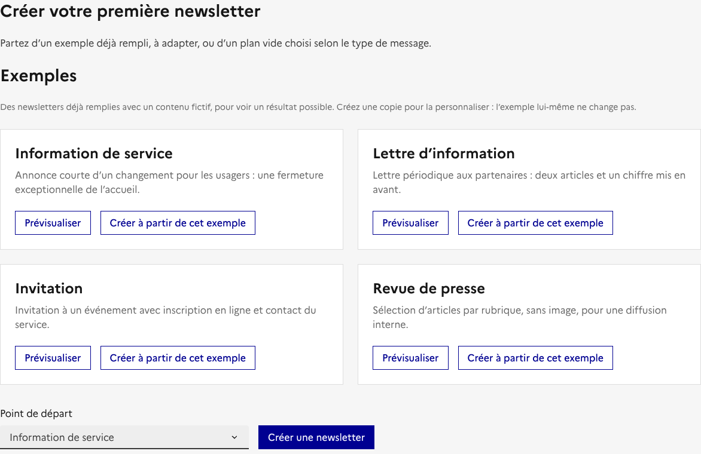
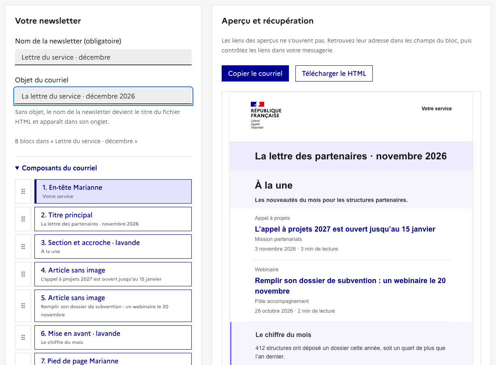
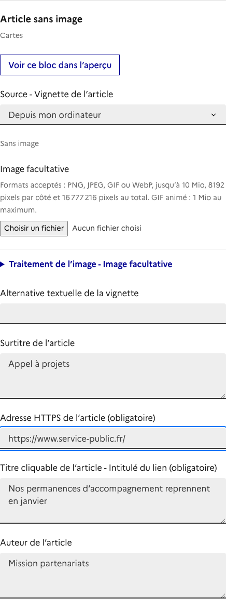
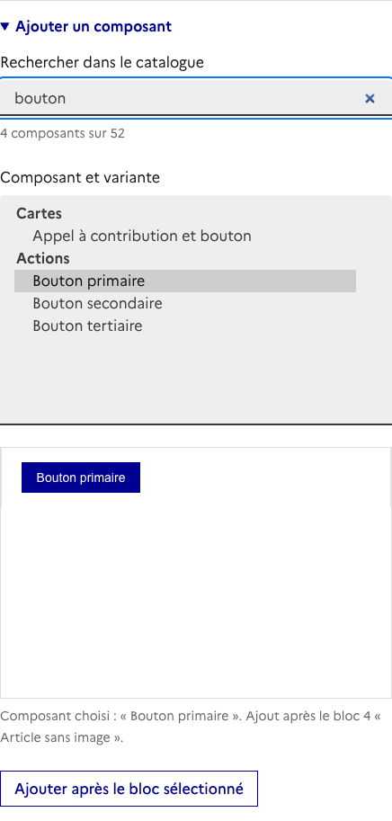
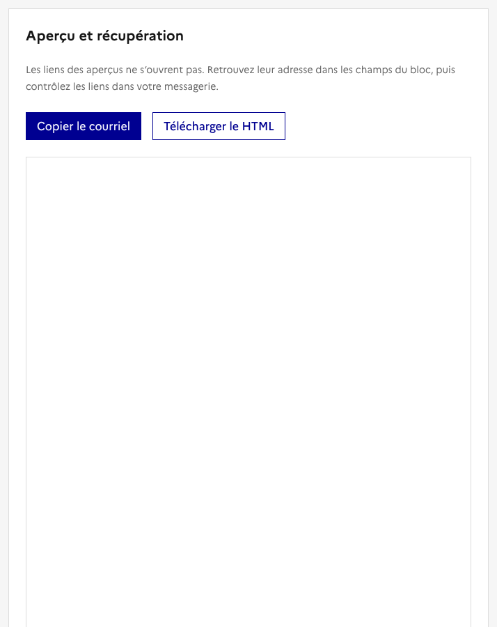
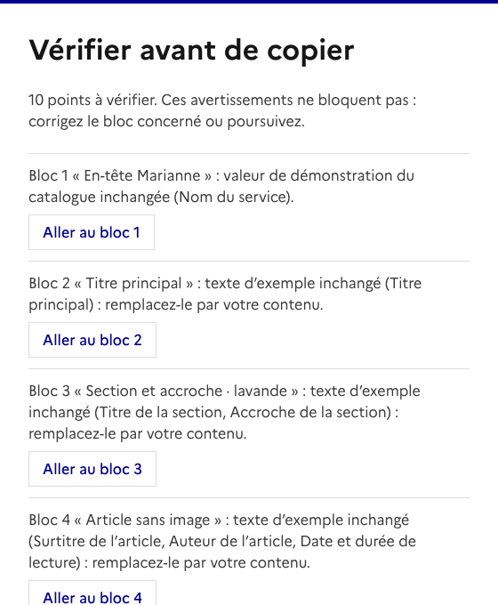
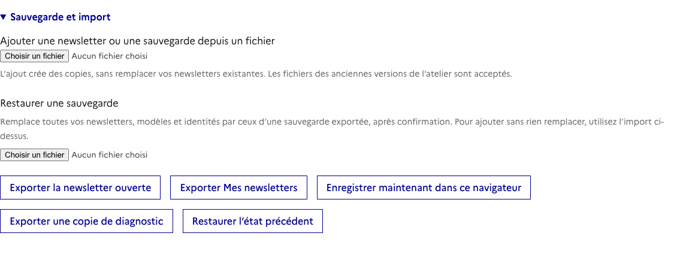

# Prendre en main l’atelier en cinq minutes

<!-- Captures régénérées par `node scripts/captures_prise_en_main.cjs`. Les libellés entre « » sont vérifiés contre l’interface par `tests/prise-en-main.test.cjs`. Chaque section numérotée correspond à une scène de la vidéo. -->

Vous allez créer une lettre d’information à partir d’un exemple, la remplir avec vos contenus, puis la coller dans votre messagerie. Il n’y a rien à installer et aucun compte à créer.

L’atelier prépare le courriel. Il ne l’envoie pas : c’est vous qui le collez dans votre messagerie et qui l’envoyez.

## 1. Partir d’un exemple

Ouvrez [l’atelier](https://alexandra-guiderdoni.github.io/builder-mail-dsfr/). Dans « Exemples », sur la carte « Lettre d’information », choisissez « Créer à partir de cet exemple ».

La newsletter est déjà remplie avec un contenu fictif : il ne reste qu’à l’adapter. « Prévisualiser » montre un exemple sans rien créer, et l’exemple lui-même ne change jamais.

## 2. Nommer votre newsletter

En haut de « Votre newsletter » :

- le **nom** sert à la retrouver dans « Mes newsletters » ;
- l’**objet** est un aide-mémoire : l’atelier ne le transmet pas à votre messagerie, vous le recopierez au moment de l’envoi.

À gauche, la liste des blocs du courriel ; à droite, l’aperçu.

## 3. Remplacer les contenus

Cliquez sur un bloc dans « Composants du courriel » : ses champs s’ouvrent juste en dessous. Remplacez les textes et les liens. Un lien est une adresse complète qui commence par `https://`. L’aperçu se met à jour pendant que vous tapez.

Commencez par le bloc 1, « En-tête Marianne » : son champ « Nom du service » affiche encore « Votre service ». Pour une image, choisissez « Depuis mon ordinateur », puis votre fichier.

**Ajouter un bloc :** ouvrez « Ajouter un composant », tapez un mot dans « Rechercher dans le catalogue » (par exemple « bouton »), choisissez le composant dans la liste, puis « Ajouter après le bloc sélectionné ».

**Organiser les blocs :** sous les champs d’un bloc, « Monter », « Descendre », « Dupliquer le bloc » et « Retirer le bloc ». Un retrait par erreur se rattrape avec « Annuler le retrait du bloc ».

## 4. Relire l’aperçu

Relisez le courriel de haut en bas, dans l’aperçu à droite. Les liens de l’aperçu ne s’ouvrent pas : vérifiez leur adresse dans les champs du bloc.

## 5. Copier, puis coller dans votre messagerie

Choisissez « Copier le courriel ».

S’il reste des contenus d’exemple, la fenêtre « Vérifier avant de copier » les liste : textes inchangés, liens de démonstration, « Votre service ». « Aller au bloc » vous amène au champ à corriger. « Copier quand même » copie malgré tout, et « Annuler » ne copie rien.

Dans votre messagerie :

1. Ouvrez un nouveau message en rédaction enrichie, pas en texte brut.
2. Cliquez dans le corps du message, puis collez (`Ctrl+V`, ou `⌘V` sur Mac).
3. Recopiez l’objet et ajoutez les destinataires.
4. **Envoyez-vous d’abord un test**, et vérifiez les liens et les images dans le message reçu.

Si le navigateur refuse la copie, « Télécharger le HTML » fournit le courriel dans un fichier.

## Ne pas perdre votre travail

L’atelier enregistre vos newsletters automatiquement, mais seulement **dans ce navigateur, sur ce poste**. Pour reprendre plus tard, rouvrez l’atelier dans le même navigateur : vos newsletters sont dans « Mes newsletters ».

Gardez-en une copie dans un fichier : tout en bas de la page, ouvrez « Sauvegarde et import », puis choisissez « Exporter Mes newsletters ». Faites-le régulièrement, et toujours avant de changer de poste ou de navigateur. Effacer les données du navigateur efface aussi vos newsletters.

Pour retrouver vos newsletters ailleurs, deux possibilités :

- « Ajouter une newsletter ou une sauvegarde depuis un fichier » ajoute le contenu du fichier à vos newsletters ;
- « Restaurer une sauvegarde » **remplace** toutes vos newsletters par celles du fichier, après confirmation.

## Quand ça coince

- **Le message reçu ne ressemble pas à l’aperçu.** L’affichage dans Outlook et dans Mélissa n’est pas encore vérifié dans tous les cas : c’est pour ça que le test envoyé à vous-même est indispensable.
- **Le collage a perdu les couleurs et les images.** Le message était en texte brut. Passez en rédaction enrichie, puis copiez de nouveau avec « Copier le courriel ».
- **« Courriel lourd : Gmail risque de n’en afficher qu’une partie ».** Allégez les images ou raccourcissez les textes, comme le conseille le message.
- **Mes newsletters ont disparu.** Vous êtes sans doute dans un autre navigateur, sur un autre poste, ou dans l’atelier portable au lieu de la version en ligne. Retrouvez-les depuis votre dernier export.

## Aller plus loin

Le [guide d’utilisation](UTILISATION.md) couvre le reste : modèles réutilisables, identités de service (pour retrouver votre en-tête et votre pied de page dans chaque newsletter), images en ligne, atelier portable et messages d’erreur.
